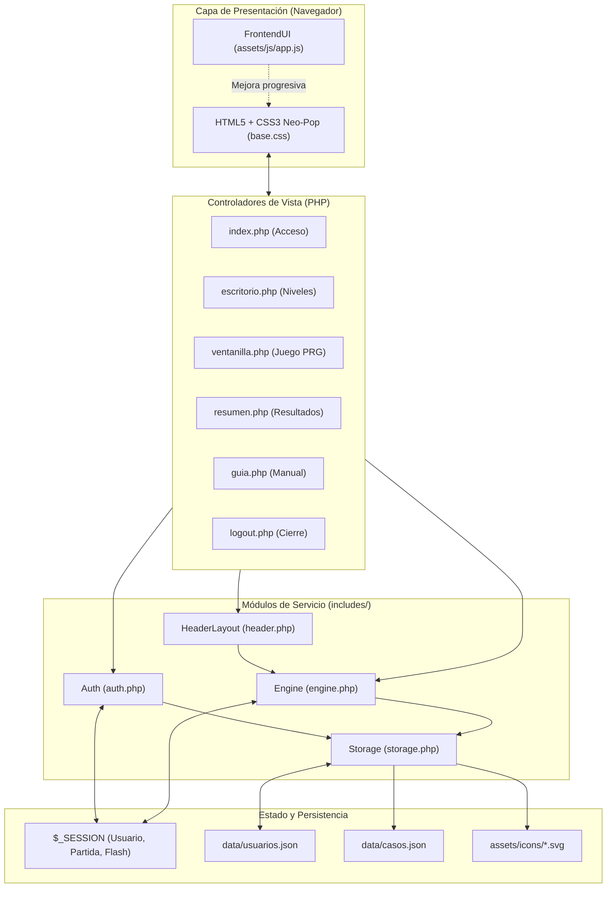
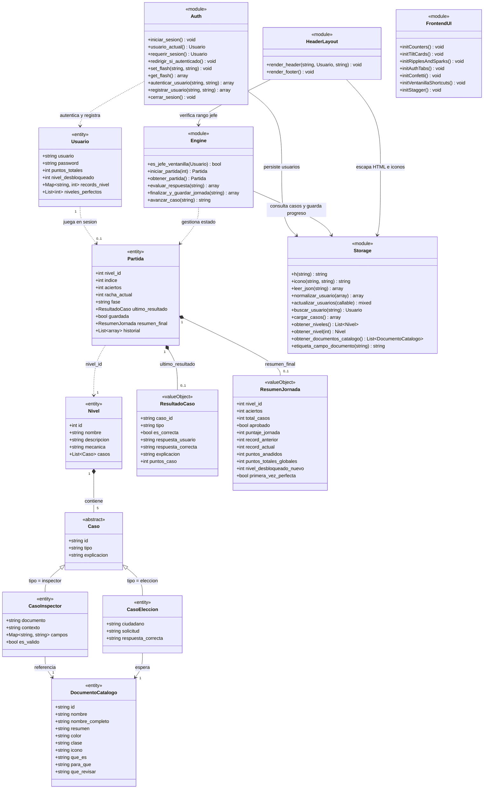
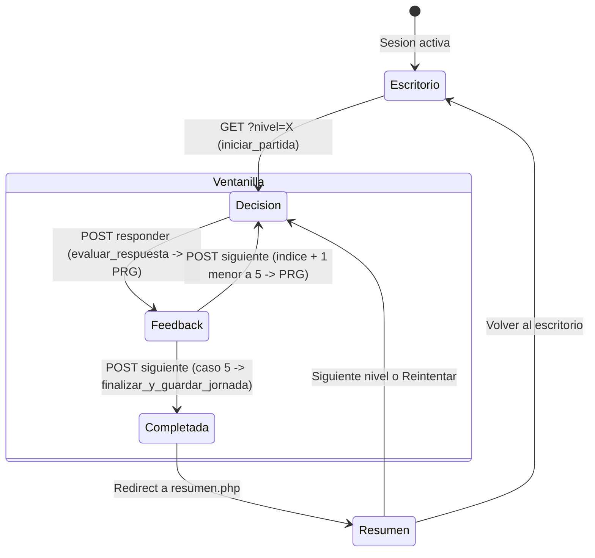

# Ventanilla Exprés

> **Simulador cívico interactivo** en PHP para dominar el uso y la validación de los cinco documentos oficiales más comunes en México (**CURP**, **NSS**, **Acta de Nacimiento**, **Recibo de CFE** y **Correo Electrónico**).

**Stack:** `PHP 8+ (strict_types)` · `JSON + flock` · `HTML5` · `CSS3 (Neo-Pop)` · `JavaScript Vanilla (ES6+)` · Sin base de datos ni frameworks externos.

---

## Tabla de Contenidos

1. [Mecánicas de Juego y Progresión](#mecánicas-de-juego-y-progresión)
2. [Arquitectura y Decisiones de Diseño](#arquitectura-y-decisiones-de-diseño)
3. [Diagrama de Clases (Dominio y Módulos)](#diagrama-de-clases-dominio-y-módulos)
4. [Qué Hace Cada Clase y Módulo](#qué-hace-cada-clase-y-módulo)
5. [Flujo de Partida (Máquina de Estados)](#flujo-de-partida-máquina-de-estados)
6. [Estructura del Proyecto](#estructura-del-proyecto)
7. [Ejecución Local](#ejecución-local)

---

## Mecánicas de Juego y Progresión

El jugador asume el rol de operador de ventanilla a través de **5 niveles (25 casos en total)** con dificultad progresiva:

| Nivel | Nombre | Mecánica | Objetivo |
| :---: | :--- | :--- | :--- |
| **01** | Recepción Básica | 5 elecciones | Identificar el documento correcto en trámites cotidianos directos. |
| **02** | Archivo en Orden | 5 elecciones | Distinguir documentos que suelen confundirse (ej. CURP vs. Acta). |
| **03** | Ojo de Águila | 5 inspecciones | Aprobar o rechazar expedientes detectando errores evidentes. |
| **04** | Ventanilla Mixta | 2 elecciones + 3 inspecciones | Combinar despacho de solicitudes con detección de errores intermedios. |
| **05** | Hora Pico | 2 elecciones + 3 inspecciones | Resolver trámites complejos e inconsistencias finas (fechas en CURP, espacios en correo, vigencia CFE). |

### Reglas de Puntuación y Controles
- **Puntaje:** `40 pts` por acierto → máximo `200 pts` por nivel y **`1,000 pts` globales**.
- **Desbloqueo:** Se requieren al menos **3/5 aciertos (`120 pts`)** para aprobar y habilitar el siguiente nivel.
- **Anti-farming:** Rejugar un nivel solo suma al marcador global la diferencia sobre tu récord anterior (`max(0, puntajeJornada - recordAnterior)`).
- **Rango Máximo:** Al alcanzar `1,000 / 1,000 pts` se obtiene la insignia **★ Jefe de Ventanilla**.
- **Atajos de teclado en Ventanilla:** `1`–`5` (elegir documento), `A` (aprobar), `R` (rechazar), `Enter` (siguiente caso / ver resumen).

---

## Arquitectura y Decisiones de Diseño

La aplicación sigue una arquitectura **MPA (Multi-Page Application) orientada a servidor en PHP** con separación clara en cuatro capas: **Cliente**, **Controladores de Vista**, **Módulos de Dominio/Servicio** y **Persistencia JSON**.



### Decisiones de Diseño Técnico
1. **Patrón PRG (Post/Redirect/Get):** Todas las acciones que mutan estado (`login`, `registro`, `responder`, `siguiente`) procesan el `POST` y redirigen inmediatamente con `302 Location`. Esto elimina envíos duplicados al refrescar el navegador (`F5`).
2. **Persistencia JSON con Bloqueo Atómico (`flock`):** En lugar de requerir un motor SQL, `storage.php` usa bloqueos compartidos (`LOCK_SH`) para leer y bloqueos exclusivos (`LOCK_EX` + `ftruncate` + `fflush`) dentro de un callback transaccional (`actualizar_usuarios`), con soporte de cancelación segura (`_abortar`) y normalización automática de invariantes (`0..200` por nivel, tope `1000` global).
3. **Estado en Sesión e Idempotencia:** La partida activa vive en `$_SESSION['partida']` (bajo la cookie `VENTANILLA_EXPRES_SESS` con `session_regenerate_id(true)`). Esto permite consultar la `guia.php` en medio de un turno sin perder progreso y garantiza mediante la bandera `guardada` que `finalizar_y_guardar_jornada()` no duplique puntos si el usuario recarga `resumen.php`.
4. **Progressive Enhancement:** Toda la jugabilidad funciona únicamente con formularios HTML y PHP; `assets/js/app.js` añade micro-interacciones no bloqueantes (atajos, tilt 3D, confeti en `<canvas>`, contadores) respetando `prefers-reduced-motion`.
5. **Seguridad:** Escape XSS sistemático con `h()`, validación server-side de niveles desbloqueados y respuestas permitidas, y sanitización de nombres de íconos SVG. *(Nota: al ser un simulador local/educativo sin entorno productivo, las contraseñas en `data/usuarios.json` se comparan en texto plano; para producción bastaría sustituir por `password_hash` / `password_verify` en `auth.php`).*

### Decisiones de Diseño Visual (UI/UX)
- **Estética Maximalista Neo-Pop Cívico Mexicano (`assets/css/base.css`):** Combina un lienzo crema cálido (`#FFF3D1`) con textura *halftone*, bordes de tinta gruesos (`3px solid #111111`), sombras duras desplazadas estilo cómic y sellos rotatorios de oficina (`★ ¡ACIERTO! ★` / `✕ ¡ERROR! ✕`).
- **Codificación Cromática por Documento:** Cada documento tiene su color e ícono SVG exclusivo para reforzar el aprendizaje visual: **CURP** (esmeralda `#00B86B`), **NSS** (cobalto `#1E40FF`), **Acta** (naranja `#FF5C1B`), **CFE** (dorado `#FFC700`) y **Correo** (violeta `#7C3AED`).
- **Jerarquía Tipográfica Tripartita:** `Bricolage Grotesque` para titulares expresivos, `Inter` para lectura clara y `Space Mono` (con `tabular-nums`) para folios, claves CURP, NSS y métricas.

---

## Diagrama de Clases (Dominio y Módulos)

> **Nota arquitectónica:** El proyecto está implementado en **PHP procedimental modular** (sin clases OOP explícitas). Las **entidades de dominio** se representan como arrays asociativos estructurados en JSON y `$_SESSION`, mientras que la lógica se agrupa en **módulos de funciones**. El siguiente diagrama UML modela esas entidades (`<<entity>>`) y módulos (`<<module>>`) junto con sus atributos, operaciones y relaciones reales.



---

## Qué Hace Cada Clase y Módulo

### 1. Entidades de Dominio (Datos)
| Clase / Entidad | Origen | Responsabilidad |
| :--- | :--- | :--- |
| **`Usuario`** | `data/usuarios.json` | Almacena credenciales, puntos globales (`0–1000`), nivel máximo desbloqueado (`1–5`), récords por nivel (`records_nivel`) y lista de niveles perfectos (`5/5`). |
| **`Nivel`** | `data/casos.json` | Define cada jornada (ID, nombre, descripción, etiqueta de mecánica) y agrupa exactamente 5 objetos `Caso`. |
| **`Caso`** (`CasoEleccion` / `CasoInspector`) | `data/casos.json` | Representa un reto individual. `CasoEleccion` plantea una solicitud ciudadana para elegir documento; `CasoInspector` presenta campos de un expediente para aprobar o rechazar. |
| **`DocumentoCatalogo`** | `includes/storage.php` | Modela la ficha oficial de cada uno de los 5 documentos (identidad visual, ícono, qué es, para qué sirve y criterios de validación) usada tanto en `ventanilla.php` como en `guia.php`. |
| **`Partida`** | `$_SESSION['partida']` | Mantiene el estado efímero de la jornada en curso: nivel actual, índice del caso (`0–4`), aciertos, racha, fase (`decision` / `feedback` / `completada`) e historial. |
| **`ResultadoCaso`** | Embebido en `Partida` | Captura la evaluación del último caso respondido (si acertó, respuesta esperada, explicación pedagógica y puntos ganados) para mostrar la retroalimentación inmediata. |
| **`ResumenJornada`** | Embebido en `Partida` | Consolida el resultado final de la jornada: puntaje obtenido, delta de puntos añadidos al global, si se aprobó, si se desbloqueó un nuevo nivel o si fue primera jornada perfecta. |

### 2. Módulos de Servicio (`includes/` y `assets/js/`)
| Módulo | Archivo | Responsabilidad |
| :--- | :--- | :--- |
| **`Storage`** | `includes/storage.php` | Capa de acceso a datos y utilidades base: lectura/escritura atómica con `flock` sobre `usuarios.json`, caché estática en memoria para `casos.json` e íconos SVG (`icono()`), normalización de usuarios, escape HTML (`h()`), catálogo de documentos y traductor de etiquetas de campos. |
| **`Auth`** | `includes/auth.php` | Gestiona el ciclo de vida de la sesión (`VENTANILLA_EXPRES_SESS`), registro con validación de unicidad y longitud (`2–24` caracteres), login, cierre seguro de cookies, guards de ruta (`requerir_sesion`, `redirigir_si_autenticado`) y mensajería flash de un solo uso. |
| **`Engine`** | `includes/engine.php` | Núcleo de reglas de negocio: inicializa partidas, valida y evalúa respuestas tanto de elección como de inspección, controla rachas, transiciona fases y persiste de forma idempotente el progreso, récords y desbloqueos al finalizar los 5 casos. |
| **`HeaderLayout`** | `includes/header.php` | Renderiza el layout común (`render_header` / `render_footer`): cabecera HTML, escenario visual neo-pop de fondo, marquesina en login o barra superior con barra de progreso global, insignia de rango y navegación contextual. |
| **`FrontendUI`** | `assets/js/app.js` | IIFE en JavaScript vanilla que orquesta las micro-interacciones: contadores animados con easing cúbico, efecto tilt 3D en tarjetas, ripples y chispas en botones, pestañas animadas de acceso, motor de confeti en `<canvas>`, atajos de teclado y animaciones escalonadas (`--stagger`). |

### 3. Controladores de Vista (Raíz)
| Archivo | Responsabilidad |
| :--- | :--- |
| **`index.php`** | Portada de acceso con vitrina visual de documentos y formulario con pestañas para **Iniciar sesión** y **Crear cuenta**. |
| **`escritorio.php`** | Tablero principal del operador: resumen de progreso global, niveles aprobados/perfectos y tarjetas de los 5 niveles con su estado (`Disponible`, `Completado`, `★ Perfecto`, `Bloqueado`). |
| **`ventanilla.php`** | Controlador PRG de la jornada activa: valida `?nivel=X`, procesa respuestas y avance de casos, y renderiza la interfaz de elección, el expediente en modo inspector y el panel de feedback con sello. |
| **`resumen.php`** | Pantalla de cierre de jornada con métricas comparativas (puntaje actual vs. récord previo), alertas de desbloqueo/rango, confeti al aprobar y acciones para avanzar o reintentar. |
| **`guia.php`** | Manual rápido con las 5 fichas de documentos oficiales; permite regresar directamente a la ventanilla sin perder la partida activa. |
| **`logout.php`** | Destruye la sesión y la cookie activa, y redirige a `index.php`. |

---

## Flujo de Partida (Máquina de Estados)

El ciclo de vida de una jornada dentro de `ventanilla.php` y `Engine` sigue una máquina de estados estricta protegida con PRG:



---

## Estructura del Proyecto

```text
Jueguito-Pingo/
├── index.php              # Acceso (Login / Registro)
├── escritorio.php         # Dashboard de niveles y estadísticas globales
├── ventanilla.php         # Pantalla principal de juego (Elección / Inspector / Feedback)
├── resumen.php            # Resumen de jornada y actualización de récords
├── guia.php               # Manual oficial de los 5 documentos
├── logout.php             # Cierre de sesión
├── includes/
│   ├── storage.php        # Persistencia JSON con flock, normalización, catálogo y helpers
│   ├── auth.php           # Sesiones, autenticación, registro y mensajes flash
│   ├── engine.php         # Motor de juego, evaluación de casos y progresión
│   └── header.php         # Layout compartido (topbar, fondo neo-pop y footer)
├── data/
│   ├── casos.json         # Banco de 5 niveles y 25 casos (elección e inspección)
│   └── usuarios.json      # Registro persistente de usuarios y récords
└── assets/
    ├── css/base.css       # Sistema de diseño Maximalista Neo-Pop Cívico
    ├── js/app.js          # Micro-interacciones, confeti Canvas y atajos de teclado
    └── icons/*.svg        # 13 íconos vectoriales embebidos en línea
```

---

## Ejecución Local

### Requisitos
- **PHP 8.0 o superior** con extensión `mbstring` habilitada.
- Permisos de lectura/escritura sobre `data/usuarios.json`.

### Iniciar el servidor integrado de PHP
Desde la raíz del proyecto, ejecuta:

```bash
php -S localhost:8000
```

Luego abre en tu navegador: **http://localhost:8000**

> También puede ejecutarse en **XAMPP**, **Laragon** o **Apache/Nginx** apuntando el DocumentRoot a la carpeta del proyecto.
